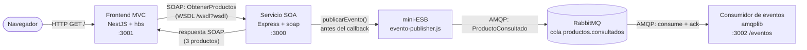

# Práctica 6 - SOA + mini-ESB + RabbitMQ + Frontend MVC (Node.js / NestJS)

**Integración de Sistemas - PUCE · Semana 5 · Reto 1**
**Autor:** Anthony Rosero (trabajo individual)

## Objetivo

Construir una arquitectura orientada a servicios donde:

1. Un **servicio SOA** expone por **SOAP** (contrato **WSDL**) la operación `ObtenerProductos`.
2. Cada consulta dispara un **evento de integración** `ProductoConsultado` que un **mini-ESB** publica en una cola de **RabbitMQ**.
3. Un **consumidor** independiente recibe los eventos de forma asíncrona.
4. Un **frontend MVC** en NestJS (vistas Handlebars renderizadas en el servidor, no SPA) consume el servicio SOAP y muestra los productos.

## Arquitectura



| Pieza | Carpeta | Tecnología | Rol |
|---|---|---|---|
| Servicio SOA | `soa-productos-service/` | Express 5, `soap`, `amqplib` | Proveedor SOAP del catálogo; publica el evento |
| mini-ESB | `soa-productos-service/evento-publisher.js` | `amqplib` | Crea el evento y lo enruta a la cola |
| Broker | `docker-compose.yml` / CloudAMQP | RabbitMQ 3 (management) | Cola `productos.consultados` |
| Consumidor | `consumidor-eventos/` | `amqplib`, `http` nativo | Procesa eventos, hace `ack`, los expone en `/eventos` |
| Frontend MVC | `frontend-mvc/` | NestJS 12, `hbs`, `soap` | Controlador → cliente SOAP → vista `index.hbs` |

Evento publicado:

```json
{
  "eventoId": "8e155d9d-041b-4185-8a51-8f4bc32d67b7",
  "tipo": "ProductoConsultado",
  "fecha": "2026-10-14T15:54:20.918Z",
  "origen": "soa-productos-service",
  "totalProductosDevueltos": 3
}
```

## Puertos y variables de entorno

| Servicio | Puerto local | Variable | Valor por defecto | Descripción |
|---|---|---|---|---|
| RabbitMQ | 5672 (AMQP), 15672 (panel) | - | `guest` / `guest` | Broker local (Docker) |
| Servicio SOA | 3000 | `PORT` | `3000` | Puerto HTTP |
| | | `AMQP_URL` | `amqp://localhost` | URL del broker (en la nube, la URL AMQPS de CloudAMQP) |
| | | `PUBLIC_URL` | `RENDER_EXTERNAL_URL` o `http://localhost:3000` | Base que se escribe en el `soap:address` del WSDL |
| Consumidor | 3002 | `PORT` | `3002` | `GET /health`, `GET /eventos` |
| | | `AMQP_URL` | `amqp://localhost` | URL del broker |
| Frontend MVC | 3001 | `PORT` | `3001` | Puerto HTTP |
| | | `SOAP_WSDL_URL` | `http://localhost:3000/wsdl?wsdl` | WSDL del servicio SOA |
| `verificar-flujo.js` | - | `FRONTEND_URL`, `SOA_URL`, `CONSUMIDOR_URL` | `http://localhost:3001`, `:3000`, `:3002` | URLs a probar |
| | | `TIMEOUT_MS`, `REINTENTOS` | `90000`, `3` | Tolerancia al arranque en frío |

La URL de CloudAMQP **no** se versiona: solo se carga como variable de entorno en Render.

## Cómo ejecutar en local

Requisitos: Node.js ≥ 20 (probado con 26.1.0), npm, Docker Desktop.

```powershell
# Terminal 1 - RabbitMQ (panel en http://localhost:15672, guest/guest)
docker compose up -d

# Terminal 2 - Servicio SOA (http://localhost:3000/wsdl?wsdl)
cd soa-productos-service
npm install
npm start

# Terminal 3 - Consumidor (http://localhost:3002/eventos)
cd consumidor-eventos
npm install
npm start

# Terminal 4 - Frontend MVC (http://localhost:3001)
cd frontend-mvc
npm install
npm run start
```

El orden importa poco: el consumidor reintenta la conexión cada 5 s si RabbitMQ no está listo, y el frontend muestra un mensaje si el SOA no responde.

## Cómo probar

| Prueba | Comando / URL | Resultado esperado |
|---|---|---|
| Contrato WSDL | http://localhost:3000/wsdl?wsdl | XML con `ObtenerProductos` |
| Salud del SOA | http://localhost:3000/health | `{"status":"ok"}` |
| Cliente SOAP de prueba | `cd soa-productos-service && npm run probar` | Los 3 productos en JSON |
| Cola en RabbitMQ | http://localhost:15672 → Queues → `productos.consultados` | Sube *Ready* si el consumidor está detenido |
| Consumidor | Consola: `[Consumidor] Evento recibido: {...}`; http://localhost:3002/eventos | Últimos 20 eventos |
| Frontend | http://localhost:3001 | Lista con los 3 productos; cada recarga genera un evento |
| Pruebas del frontend | `cd frontend-mvc && npm test && npm run test:e2e` | 4 + 3 pruebas en verde (cliente SOAP simulado) |
| End-to-end | `node verificar-flujo.js` (desde la raíz) | `PASS` en los 3 puntos |

Contra la nube:

```powershell
$env:FRONTEND_URL="https://<frontend>.onrender.com"; $env:SOA_URL="https://<soa>.onrender.com"; $env:CONSUMIDOR_URL="https://<consumidor>.onrender.com"; node verificar-flujo.js
```

Salidas guardadas en `evidencias/verificar-flujo-local.txt` y `evidencias/verificar-flujo-nube.txt`.

## Despliegue en la nube

- **RabbitMQ:** CloudAMQP, plan gratuito *Little Lemur* (URL `amqps://...` solo como variable `AMQP_URL` en Render).
- **Render:** Blueprint `render.yaml` con tres Web Services del plan *free* (uno por carpeta, `rootDir`).

| Servicio | URL pública |
|---|---|
| Frontend MVC | _pendiente_ |
| Servicio SOA (WSDL) | _pendiente_ |
| Consumidor (`/eventos`) | _pendiente_ |

> **Plan free de Render:** los servicios se duermen tras ~15 min sin tráfico y el primer acceso tarda de 30 s a ~1 min en despertar (si el frontend y el SOA están dormidos, se suman). Por eso el frontend espera hasta 60 s al SOA y `verificar-flujo.js` usa timeouts de 90 s con 3 reintentos y primero "despierta" los servicios con `/health`. Además, el consumidor guarda los eventos **en memoria**: al dormirse o reiniciarse, `/eventos` vuelve a cero, y mientras está dormido los eventos se acumulan en la cola de CloudAMQP y se procesan al despertar.

## Preguntas "Pregúntate"

**¿Qué diferencia hay entre un WSDL, un `.proto` (gRPC) y un OpenAPI (REST)?**
Los tres son contratos de interfaz legibles por máquina, pero de estilos distintos. El **WSDL** describe servicios SOAP: operaciones, mensajes XML tipados con XSD, binding (document/literal sobre HTTP) y la dirección del endpoint; es verboso y orientado a operaciones. El **`.proto`** define mensajes y RPC para gRPC con serialización binaria Protobuf sobre HTTP/2; es compacto, rápido y genera código fuertemente tipado. **OpenAPI** describe APIs REST orientadas a recursos (rutas, verbos HTTP, JSON Schema, códigos de estado); es el más usado en la web y en herramientas de documentación. En los tres, el contrato es lo primero y permite generar clientes (aquí, `soap.createClient` construye el cliente leyendo el WSDL).

**¿Por qué se publica el evento antes de llamar al `callback`?**
Porque el evento es parte de la operación: al publicarlo antes de responder, cuando el cliente recibe la respuesta el hecho "se consultaron productos" ya quedó registrado en el broker, y no se pierde si el proceso falla justo después de responder. Como la publicación está dentro de `try/catch`, un fallo de RabbitMQ solo se registra en el log y el cliente recibe igual sus productos: la mensajería no debe tumbar el servicio principal. El costo es que la latencia de la respuesta incluye la publicación (aquí se abre una conexión AMQP por petición).

## Limitaciones conocidas

- La cola `productos.consultados` es **no durable** (como pide la guía) y los mensajes no son persistentes: si RabbitMQ se reinicia, se pierden los eventos pendientes.
- El mini-ESB abre y cierra **una conexión AMQP por cada petición SOAP** (simple, pero costoso bajo carga).
- Si RabbitMQ no responde (host inaccesible, no rechazado), la respuesta SOAP espera lo que tarde `amqp.connect` en fallar.
- El consumidor guarda los eventos solo en memoria (últimos 20) y no hay base de datos.
- El WSDL declara `productos` como `xsd:string` (tal como la guía), aunque se envían objetos con `id`, `nombre` y `precio`; los valores llegan al cliente como texto.
- No hay autenticación en ningún servicio (práctica académica).

## Estructura

```
practica-6-soa-esb-rabbitmq/
├── soa-productos-service/   index.js, productos.wsdl, productos.js, evento-publisher.js, probar-cliente.js
├── consumidor-eventos/      index.js
├── frontend-mvc/            src/ (main.ts, app.controller.ts), views/index.hbs, public/styles.css, test/
├── evidencias/              salidas de verificar-flujo.js
├── docker-compose.yml
├── render.yaml
├── verificar-flujo.js
├── README.md
├── DECLARACION_IA.md
└── AUDITORIA_PRACTICA_6.md
```
